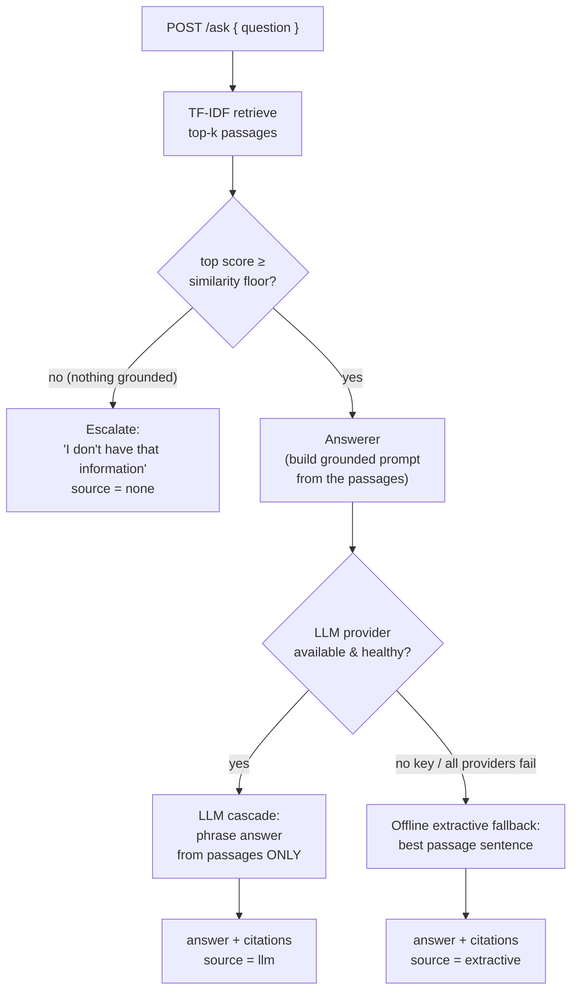

# docintel

A **provider-agnostic RAG / document-QA microservice** built with Spring Boot 3
and Java 21. It answers questions grounded in a document corpus, returns the passages it
used as **citations**, and **keeps working with no LLM and no network**.

The engine puts the part that must be correct where it can be measured: **retrieval is the
deterministic core**, implemented as TF-IDF + cosine similarity in plain Java, unit-tested,
and benchmarked against a real public gold set (see
[Measured on real inputs](#measured-on-real-inputs-squad-v11)). A language model, when
configured, only *phrases* the answer from the retrieved context — it never invents facts.
With no API key, a deterministic **offline extractive fallback** keeps the service fully
working, and a **grounding floor** stops the service from answering when retrieval found
nothing relevant.

[](.github/workflows/ci.yml)
[](pom.xml)
[](pom.xml)
[](LICENSE)

---

## Why

Most RAG demos collapse the moment the LLM key is missing, the provider is down, or the
network is unavailable — and they happily answer ungrounded when retrieval returns
nothing. `docintel` is structured so that:

- the part that must be **correct and testable** (retrieval, grounding, citations) does
  not depend on any external service;
- the LLM is an **interchangeable, optional** component behind a small interface;
- the service has a **defined behaviour when it does not know** (escalate, don't guess).

## How it works



The LLM is reached through a cascade: configured providers are tried in order, each guarded
so it only activates when its API key is present, and the always-available offline fallback
sits at the end. Either way, the retrieved passages are returned as citations and the
response records which path produced the answer.

## Quick start

Requires JDK 21. From the project root:

```bash
mvn spring-boot:run
```

The service starts on `http://localhost:8080` with a seeded product-support corpus.
**No API key is required** — it answers extractively out of the box.

### Ask a question (offline, grounded extractive answer with citations)

```bash
curl -s -X POST localhost:8080/ask \
  -H 'Content-Type: application/json' \
  -d '{"question":"How long are uploaded documents retained?"}'
```

```json
{
  "answer": "Uploaded documents are retained for 90 days by default.",
  "source": "extractive",
  "citations": [
    {
      "passageId": "doc-retention#0",
      "documentId": "doc-retention",
      "documentTitle": "Data retention",
      "snippet": "Uploaded documents are retained for 90 days by default.",
      "score": 0.648
    }
  ],
  "confidence": 0.648,
  "escalated": false
}
```

### Ask something outside the corpus (grounding floor → escalate)

```bash
curl -s -X POST localhost:8080/ask \
  -H 'Content-Type: application/json' \
  -d '{"question":"How do I bake sourdough bread at home?"}'
```

```json
{
  "answer": "I don't have that information in the current document corpus. Escalating to a human instead of answering without grounding.",
  "source": "none",
  "citations": [],
  "confidence": 0.0,
  "escalated": true
}
```

### Switching on a real LLM

Set a provider API key and restart; the matching adapter activates automatically and
`source` becomes `llm`, while retrieval, grounding and citations stay exactly the same:

```bash
ANTHROPIC_API_KEY=sk-ant-... mvn spring-boot:run
# or
OPENAI_API_KEY=sk-... mvn spring-boot:run
```

Provider order, models and the similarity floor are configurable in
[`application.yml`](src/main/resources/application.yml).

### Managing the corpus

```bash
curl -s localhost:8080/documents

curl -s -X POST localhost:8080/documents \
  -H 'Content-Type: application/json' \
  -d '{"id":"doc-sla","title":"Service levels","text":"The platform targets 99.9 percent uptime measured monthly."}'
```

Added documents are split into passages and are immediately retrievable.

## API

| Method | Path         | Purpose                                                            |
|--------|--------------|--------------------------------------------------------------------|
| POST   | `/ask`       | `{question}` → `{answer, source, citations, confidence, escalated}` |
| GET    | `/documents` | List the corpus with per-document passage counts                   |
| POST   | `/documents` | `{id?, title, text}` → add a document (split into passages)        |

`source` is one of `llm`, `extractive` or `none`.

## Design

- **Retrieval is the deterministic core.** TF-IDF with smoothed IDF and cosine similarity
  is implemented from scratch in [`retrieval`](src/main/java/com/angelo/docintel/retrieval)
  — no magic, no randomness, fully unit-tested. If retrieval is wrong, nothing downstream
  can be right, so this is where the tests concentrate.
- **The LLM only phrases grounded context.** The answerer builds a prompt from the
  retrieved passages and instructs the model to answer *only* from them and to cite them.
  The model is reached through the [`LlmClient`](src/main/java/com/angelo/docintel/llm/LlmClient.java)
  interface and a [`CascadeLlmClient`](src/main/java/com/angelo/docintel/llm/CascadeLlmClient.java);
  provider adapters are thin HTTP clients that activate only when their key is set.
- **The offline fallback keeps it working.** With no key (or when every provider fails),
  the [`OfflineLlmClient`](src/main/java/com/angelo/docintel/llm/OfflineLlmClient.java)
  composes an answer straight from the top passage — the returned text is always a verbatim
  span of a retrieved passage, so it cannot drift off-corpus. This is also what lets the
  entire test suite run offline with no network and no key.
- **The grounding floor prevents ungrounded answers.** If the best passage scores below a
  configurable cosine floor, the service returns "I don't have that information" and
  escalates, rather than handing the LLM thin context to confabulate from.
- **Citations are always returned** for a grounded answer, so every claim can be checked
  against the corpus.

## Measured on real inputs (SQuAD v1.1)

Retrieval quality is not asserted on hand-picked examples — it is measured end-to-end on a
real, public question-answering-over-documents gold set. The benchmark
([`SquadBenchmarkTest`](src/test/java/com/angelo/docintel/eval/SquadBenchmarkTest.java))
ingests a vendored slice of **SQuAD v1.1** (the first 1 200 validation questions over 152
Wikipedia paragraphs from four articles; source, license and regeneration in
[`src/test/resources/squad/README.md`](src/test/resources/squad/README.md)) through
DocIntel's own pipeline and scores it against SQuAD's gold labels. It runs as part of
`mvn test`.

**Retrieval** — did the engine retrieve the paragraph the answer was written against?
Chance over 152 documents is ~0.7 %.

| Metric | DocIntel engine | First-K baseline | Scrambled (negative control) |
|---|--:|--:|--:|
| recall@1 | **0.651** | 0.025 | 0.008 |
| recall@3 | **0.822** | 0.025 | 0.033 |
| recall@5 | **0.869** | 0.046 | 0.058 |
| MRR@10 | **0.747** | 0.032 | 0.028 |

**Answer** — did the surfaced text carry the gold answer? Engine retrieval vs the same
answerer run on a retrieval-ablated (first-passage) pipeline:

| Metric | Engine retrieval | Retrieval ablated |
|---|--:|--:|
| answer-containment | **0.608** | 0.021 |
| token-F1 | **0.110** | 0.014 |
| exact-match | 0.000 | 0.000 |

**What this shows.** TF-IDF retrieval finds the gold source paragraph as its top result for
**65 %** of 1 200 questions (26× a query-independent baseline) and within the top 3 for
**82 %**, and the grounded answer carries the gold span **29×** more often than when
retrieval is ablated. The **negative control** — scrambling the question↔document pairing —
collapses recall@1 from 0.651 to 0.008, right down to the chance baseline, which proves the
scores come from genuine query/document grounding and not from a corpus artefact. Every
number above is pinned in the test and cross-checked by an independent second implementation
(walked through in [`docs/estudio/06-benchmark-inputs-reales.md`](docs/estudio/06-benchmark-inputs-reales.md)).

Exact-match is 0 by design: the offline fallback returns a whole grounding *sentence*, never
a minimal span, so it scores low on *span-exact* metrics while scoring high on
*answer-containment* — the metric that matches a sentence-extractive answerer. Raising
exact-match is the span-extraction extension below.

## Extending the engine

Each stage is a seam built to be swapped or strengthened:

- **Semantic retrieval.** Retrieval is lexical TF-IDF, so it matches words rather than
  meaning. The [`Retriever`](src/main/java/com/angelo/docintel/retrieval/Retriever.java)
  interface lets you add an embeddings + vector-database retriever (pgvector, Qdrant,
  Elasticsearch) and fuse it with the lexical signal (hybrid / reciprocal-rank fusion); the
  SQuAD benchmark is ready to measure the gain.
- **Structure-aware chunking.** [`PassageSplitter`](src/main/java/com/angelo/docintel/corpus/PassageSplitter.java)
  chunks at sentence granularity with a minimum length; overlapping windows, token budgets
  and heading-aware splitting plug in behind the same `Passage` model.
- **Span extraction.** Adding answer-span localisation on top of the retrieved sentence
  turns the extractive fallback into a span answerer and lifts exact-match / token-F1.
- **Persistence and scale.** The corpus is in-memory via
  [`DocumentStore`](src/main/java/com/angelo/docintel/corpus/DocumentStore.java), rebuilt on
  restart; a persistent store and vector index drop in behind the same component boundary.
- **Richer provider adapters.** The HTTP adapters cover the grounded request/response path;
  streaming, retry/backoff and token accounting are natural additions behind
  [`LlmClient`](src/main/java/com/angelo/docintel/llm/LlmClient.java).

See [`docs/architecture.md`](docs/architecture.md) and the ADRs under
[`docs/adr`](docs/adr) for the reasoning behind each decision, and
[`docs/estudio`](docs/estudio) for a study guide (in Spanish).

## Development

```bash
mvn test            # full suite, runs offline with a fake LLM — no network, no key
mvn spring-boot:run # start the service on :8080
```

## License

[MIT](LICENSE) © Angelo David Padilla Romero
