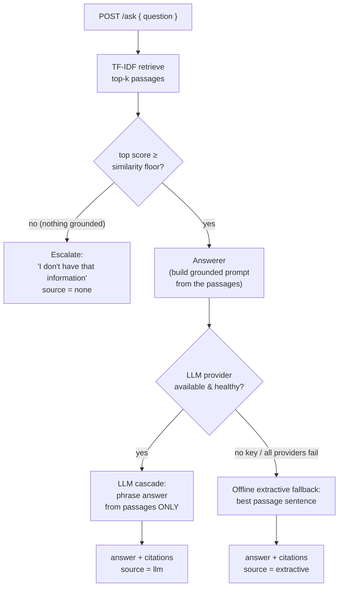

# docintel

A small, **provider-agnostic RAG / document-QA microservice** built with Spring Boot 3
and Java 21. It answers questions grounded in a document corpus, returns the passages it
used as **citations**, and **degrades gracefully with no LLM and no network**.

The design is deliberately honest about where the intelligence lives: **retrieval is the
deterministic core**, implemented as TF-IDF + cosine similarity in plain Java and covered
by unit tests. A language model, when configured, only *phrases* the answer from the
retrieved context — it never invents facts. With no API key, a deterministic **offline
extractive fallback** keeps the service fully working, and a **grounding floor** stops the
service from answering when retrieval found nothing relevant.

[](.github/workflows/ci.yml)
[](pom.xml)
[](pom.xml)
[](LICENSE)

---

## Why

Most RAG demos collapse the moment the LLM key is missing, the provider is down, or the
network is unavailable — and they happily answer ungrounded when retrieval returns
nothing. `docintel` is structured so that:

- the part that must be **correct and testable** (retrieval, grounding, citations) does
  not depend on any external service;
- the LLM is an **interchangeable, optional** component behind a small interface;
- the service has a **defined behaviour when it does not know** (escalate, don't guess).

## How it works



The LLM is reached through a cascade: configured providers are tried in order, each guarded
so it only activates when its API key is present, and the always-available offline fallback
sits at the end. Either way, the retrieved passages are returned as citations and the
response records which path produced the answer.

## Quick start

Requires JDK 21. From the project root:

```bash
mvn spring-boot:run
```

The service starts on `http://localhost:8080` with a small seeded corpus (product-support
knowledge base). **No API key is required** — it answers extractively out of the box.

### Ask a question (offline, grounded extractive answer with citations)

```bash
curl -s -X POST localhost:8080/ask \
  -H 'Content-Type: application/json' \
  -d '{"question":"How long are uploaded documents retained?"}'
```

```json
{
  "answer": "Uploaded documents are retained for 90 days by default.",
  "source": "extractive",
  "citations": [
    {
      "passageId": "doc-retention#0",
      "documentId": "doc-retention",
      "documentTitle": "Data retention",
      "snippet": "Uploaded documents are retained for 90 days by default.",
      "score": 0.648
    }
  ],
  "confidence": 0.648,
  "escalated": false
}
```

### Ask something outside the corpus (grounding floor → escalate)

```bash
curl -s -X POST localhost:8080/ask \
  -H 'Content-Type: application/json' \
  -d '{"question":"How do I bake sourdough bread at home?"}'
```

```json
{
  "answer": "I don't have that information in the current document corpus. Escalating to a human instead of answering without grounding.",
  "source": "none",
  "citations": [],
  "confidence": 0.0,
  "escalated": true
}
```

### Switching on a real LLM

Set a provider API key and restart; the matching adapter activates automatically and
`source` becomes `llm`, while retrieval, grounding and citations stay exactly the same:

```bash
ANTHROPIC_API_KEY=sk-ant-... mvn spring-boot:run
# or
OPENAI_API_KEY=sk-... mvn spring-boot:run
```

Provider order, models and the similarity floor are configurable in
[`application.yml`](src/main/resources/application.yml).

### Managing the corpus

```bash
curl -s localhost:8080/documents

curl -s -X POST localhost:8080/documents \
  -H 'Content-Type: application/json' \
  -d '{"id":"doc-sla","title":"Service levels","text":"The platform targets 99.9 percent uptime measured monthly."}'
```

Added documents are split into passages and are immediately retrievable.

## API

| Method | Path         | Purpose                                                            |
|--------|--------------|--------------------------------------------------------------------|
| POST   | `/ask`       | `{question}` → `{answer, source, citations, confidence, escalated}` |
| GET    | `/documents` | List the corpus with per-document passage counts                   |
| POST   | `/documents` | `{id?, title, text}` → add a document (split into passages)        |

`source` is one of `llm`, `extractive` or `none`.

## Design

- **Retrieval is the deterministic core.** TF-IDF with smoothed IDF and cosine similarity
  is implemented from scratch in [`retrieval`](src/main/java/com/angelo/docintel/retrieval)
  — no magic, no randomness, fully unit-tested. If retrieval is wrong, nothing downstream
  can be right, so this is where the tests concentrate.
- **The LLM only phrases grounded context.** The answerer builds a prompt from the
  retrieved passages and instructs the model to answer *only* from them and to cite them.
  The model is reached through the [`LlmClient`](src/main/java/com/angelo/docintel/llm/LlmClient.java)
  interface and a [`CascadeLlmClient`](src/main/java/com/angelo/docintel/llm/CascadeLlmClient.java);
  provider adapters are thin HTTP clients that activate only when their key is set.
- **The offline fallback keeps it working.** With no key (or when every provider fails),
  the [`OfflineLlmClient`](src/main/java/com/angelo/docintel/llm/OfflineLlmClient.java)
  composes an answer straight from the top passage — the returned text is always a verbatim
  span of a retrieved passage, so it cannot drift off-corpus. This is also what lets the
  entire test suite run offline with no network and no key.
- **The grounding floor prevents ungrounded answers.** If the best passage scores below a
  configurable cosine floor, the service returns "I don't have that information" and
  escalates, rather than handing the LLM thin context to confabulate from.
- **Citations are always returned** for a grounded answer, so every claim can be checked
  against the corpus.

## Scope and honest limitations

This is a focused portfolio service, not a production RAG platform. In particular:

- **Retrieval is lexical (TF-IDF), not semantic.** It matches words, not meaning, so
  paraphrases that share no vocabulary with the corpus will miss. Production would use
  **embeddings + a real vector database** (pgvector, Qdrant, Elasticsearch, …) alongside or
  instead of the lexical signal.
- **Chunking is naive** (sentence-level with a minimum length). A real system needs a
  deliberate **chunking strategy**: overlapping windows, token budgets, and
  structure-aware splitting.
- **The corpus is in-memory** and reseeded on restart; there is no persistence, no
  multi-tenancy, no auth.
- **There is no evaluation harness.** A production system needs an **eval set** with
  retrieval metrics (recall@k, MRR) and answer-quality / faithfulness checks to catch
  regressions.
- The HTTP provider adapters are intentionally minimal (no streaming, no retry/backoff,
  no token accounting).

See [`docs/architecture.md`](docs/architecture.md) and the ADRs under
[`docs/adr`](docs/adr) for the reasoning behind each decision, and
[`docs/estudio`](docs/estudio) for a study guide (in Spanish).

## Development

```bash
mvn test            # full suite, runs offline with a fake LLM — no network, no key
mvn spring-boot:run # start the service on :8080
```

## License

[MIT](LICENSE) © 2026 Angelo David Padilla Romero
