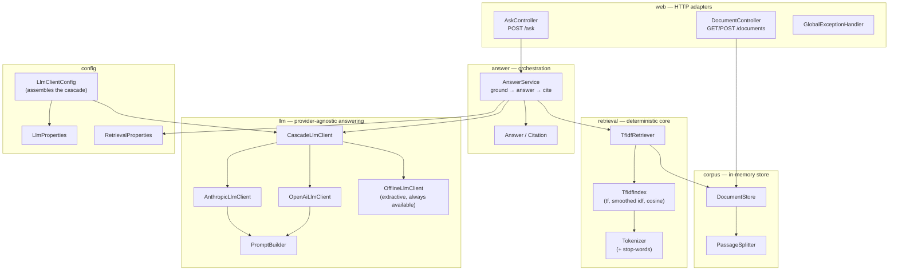

# Architecture

`docintel` is a single Spring Boot service with a clear, one-directional dependency flow:
the web layer calls the answer service, which orchestrates retrieval and the LLM cascade
over an in-memory corpus. Nothing below the web layer depends on HTTP, and nothing in the
retrieval core depends on the LLM.

## Components



## Request flow for `POST /ask`

```mermaid
sequenceDiagram
    participant Client
    participant AskController
    participant AnswerService
    participant TfIdfRetriever
    participant CascadeLlmClient
    participant Offline as OfflineLlmClient

    Client->>AskController: {question}
    AskController->>AnswerService: ask(question)
    AnswerService->>TfIdfRetriever: retrieve(question, topK)
    TfIdfRetriever-->>AnswerService: scored passages
    alt top score < similarity floor
        AnswerService-->>AskController: escalate (source=none, no citations)
    else grounded
        AnswerService->>CascadeLlmClient: answer(question, passages)
        Note over CascadeLlmClient: try providers in order;<br/>skip if no key; fall through on failure
        CascadeLlmClient->>Offline: answer(...)  (no key configured)
        Offline-->>CascadeLlmClient: extractive text (source=extractive)
        CascadeLlmClient-->>AnswerService: result
        AnswerService-->>AskController: answer + citations + confidence
    end
    AskController-->>Client: AskResponse (JSON)
```

## Key properties

- **Deterministic core.** `TfIdfIndex` carries no randomness and makes no external calls;
  given the same corpus and query it always returns the same ranking.
- **Lazy index rebuild.** `TfIdfRetriever` rebuilds its index only when the
  `DocumentStore` version changes, so documents added at runtime are reflected immediately.
- **Optional, swappable LLM.** `LlmClientConfig` builds the cascade from
  `docintel.llm.providers`; adapters are added only when their API key is present, and the
  offline fallback is always last. The offline-only cascade is what the tests exercise.
- **Grounding before answering.** The similarity floor is enforced in `AnswerService`
  before any LLM is consulted.
